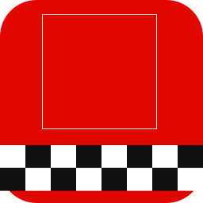
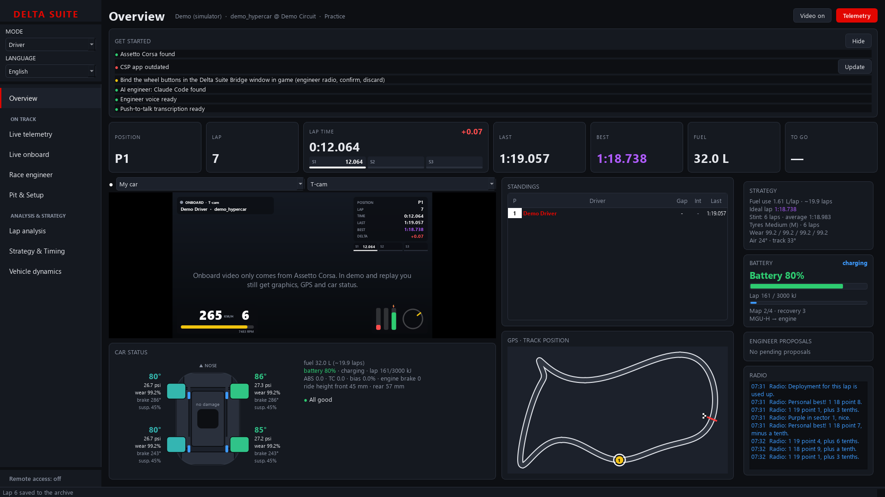
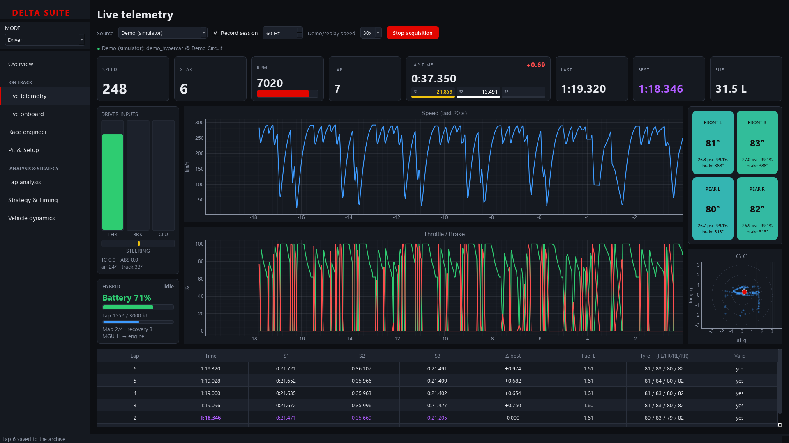
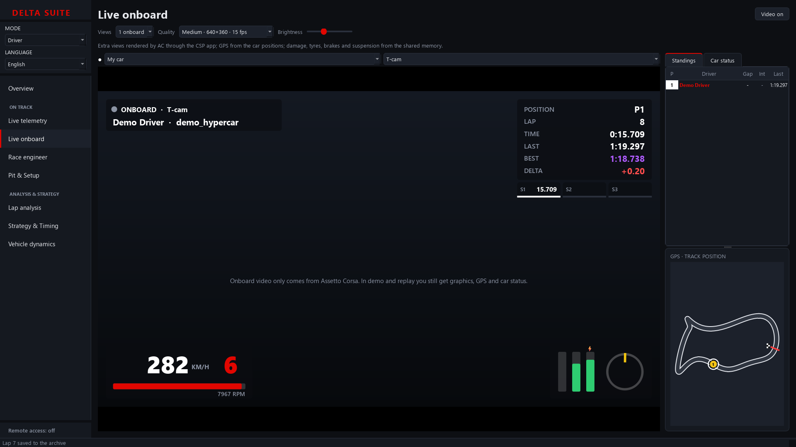
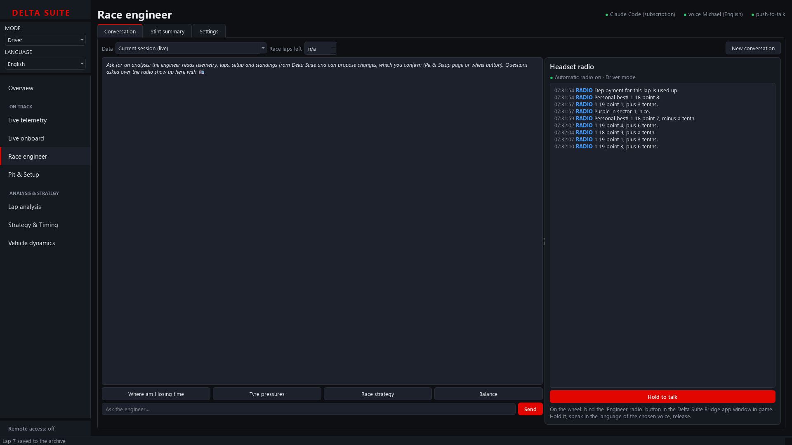
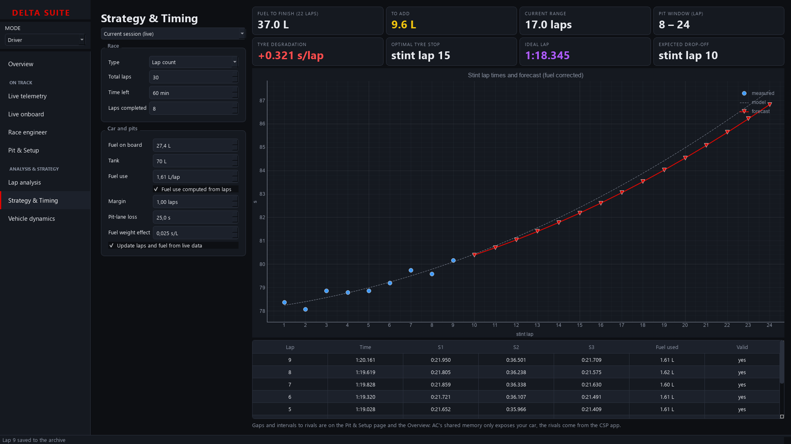

<div align="center">



# Delta Suite

**A race-engineering and strategy suite for Assetto Corsa**

Live telemetry · multi-view onboard with TV graphics · an AI race engineer in your headset ·
lap analysis · strategy & timing · vehicle dynamics. All in one Windows desktop app.

[](https://github.com/Ananas2916/delta-suite/actions/workflows/build.yml)
[](https://github.com/Ananas2916/delta-suite/releases/latest)
[](LICENSE)


[**Download**](https://github.com/Ananas2916/delta-suite/releases/latest) ·
[Features](#features) · [Quick start](#quick-start) · [How it works](#how-it-works) · [Development](#development)

</div>



Delta Suite brings the pit-wall tools of F1, WEC and GT racing to **Assetto Corsa (the original, 2014)**.
It reads telemetry straight from AC's shared memory, talks to the game through a small Custom Shaders Patch
app, and puts a race engineer on the radio: instant scripted calls like in the F1 games, plus an AI
engineer (Claude Code or the Anthropic API) you can talk to with push-to-talk from your wheel. The interface
is in English or Italian; the radio speaks six languages.

> [!NOTE]
> Delta Suite works with **Assetto Corsa 1.x** only. ACC and AC EVO use a different shared memory layout.

## Features

**Overview** — everything at once, like on the pit wall: session and flag, the key numbers, the main
onboard with TV graphics, standings, track GPS, car status and alerts, strategy, hybrid battery, the
engineer's proposals and the radio log. A *Get started* list on top shows what is ready and what is missing,
with the button that fixes each item.

### On track

| Module | What it does | Replaces |
|---|---|---|
| **Live telemetry** | 60–200 Hz dashboard: speed, RPM, pedals, steering, tyres, brakes, G-G, hybrid battery and ERS, laps and sectors with live delta (against today's best or your all-time best); session recording and replay, rivals included | MoTeC i2, ATLAS, WinDARAB |
| **Live onboard** | Up to 4 onboards at once (T-cam, bonnet, rear, wheels, chase, your car's F6 cameras; rivals too) with TV graphics, standings, track GPS and a top-down car status: damage per zone, tyres, brakes, suspension, dirt, battery and alerts | Pit-wall onboard feeds |
| **Race engineer** | One agent for written analysis and headset radio: reads Delta Suite's data, analyses corner by corner, answers push-to-talk from the wheel and proposes setup and strategy changes; plus an automatic radio with a natural voice (lap, fuel, tyres, gaps, flags, positions, damage) | Team engineer and radio |
| **Pit & Setup** | Live brake bias, ABS, TC and engine brake; full setup; the engineer's proposals to confirm; standings with gap and interval | Pit wall |

### Analysis & strategy

| Module | What it does | Replaces |
|---|---|---|
| **Lap analysis** | Up to 4 overlaid laps by distance plus a reference lap from any past session, Delta-T, racing line, synced cursor, DuckDB archive, Parquet export | MoTeC i2, Pi Toolbox |
| **Strategy & Timing** | Race, laps and fuel taken from the session (or your what-if numbers), fuel plan and pit window, tyre degradation forecast, optimal stop, ideal lap | HH Timing, SBG RaceWatch |
| **Vehicle dynamics** | Pacejka tyre, friction ellipse, load transfer with aero, double-wishbone kinematics and roll centre | ChassisSim, OptimumG, Adams |

<table>
<tr>
<td><br><sub>Live telemetry</sub></td>
<td><br><sub>Live onboard</sub></td>
</tr>
<tr>
<td><br><sub>Race engineer</sub></td>
<td><br><sub>Strategy & Timing</sub></td>
</tr>
</table>

### The race engineer

- **Instant radio, no AI, zero tokens**: lap time and delta, fuel, tyres out of the window, gaps with the
  trend ("ahead 1.2, closing 3 tenths a lap"), flags with the distance ("double yellow, stopped car in
  350 metres"), positions and overtakes by name, rivals pitting (undercut/overcut), purple sectors, pace,
  punctures and damage, last lap, finish. Pick how chatty it is (Essential, Normal, Chatty). It only speaks
  when you are not braking or mid-corner.
- **Push-to-talk from the wheel**: ask a question, local Whisper transcribes it and the AI engineer
  answers in your headset with the real session data.
- **Proposals, never actions**: the agent can only *propose* changes (brake bias, ABS, TC, engine brake,
  setup items). Nothing is applied until you confirm with a wheel button or in the app.
- **Your subscription, not an API key**: with Claude Code the engineer runs on your existing login. The
  agent only sees Delta Suite's data through a local MCP server; it cannot run commands or touch files.
- **Six radio languages**: the chosen voice decides the spoken language (English US/UK, Italian, Spanish,
  French, Portuguese).
- **Remote pit wall**: a friend on another PC, tablet or phone — on your network or through Tailscale — opens
  the whole suite in a browser: pit wall with GPS, onboard video, setup and live adjustments, strategy, laps
  and the engineer chat with the radio audio. The video is rendered in AC only while someone watches it. Light
  enough for an old laptop. Pairing uses a code that changes every 10 seconds; off by default.

## Quick start

1. **Download** `DeltaSuite.exe` from the [latest release](https://github.com/Ananas2916/delta-suite/releases/latest)
   and run it. No installation needed. The exe is not code-signed yet: if Windows SmartScreen warns you,
   click *More info → Run anyway* (the release also lists the file's SHA-256 checksum). The *Get started*
   list on the Overview then walks you through the rest.
2. **Try it without AC**: on the Overview page click *Start demo* — a simulated hybrid hypercar laps a
   synthetic track so every page has data.
3. **With Assetto Corsa**: start a session (Content Manager is fine), then *Live telemetry → Start
   acquisition* with the "Assetto Corsa" source. Tick *Record session* to save it for replay.
4. **Install the CSP app** (needs Custom Shaders Patch): *Pit & Setup → Install CSP app in AC*. In game,
   open **Delta Suite Bridge** from the app bar and bind the buttons: engineer radio (hold), confirm
   proposal, discard proposal. It unlocks rivals and standings, live setup, onboard video and the radio
   buttons.
5. **Set up the engineer**: *Race engineer → Settings*. Click *Download voice* (~120 MB, once) for the
   engineer's voice. With [Claude Code](https://docs.anthropic.com/en/docs/claude-code) installed and logged
   in there is nothing else to do.
6. **Language**: *Language* in the sidebar (English / Italiano), applied at the next start
   ([Italian interface](docs/screenshots/overview_it.png)).

<details>
<summary><b>Voice and transcription</b></summary>

- **Voice**: built-in [Kokoro](https://github.com/thewh1teagle/kokoro-onnx) (34 voices). *Download voice*
  puts the model in `%LOCALAPPDATA%\DeltaSuite\models\kokoro`; you can also point *Kokoro model* to a folder
  containing `kokoro-v1.0.onnx` and `voices-v1.0.bin` (models installed by Tsukumo are found automatically).
- **Transcription**: local Whisper via `faster-whisper` (`base` model by default, ~1 s on CPU). Models
  live in the Hugging Face cache and are downloaded on first use.
- `DELTA_MUTE=1` silences the voice.

</details>

<details>
<summary><b>Using another AI agent</b></summary>

*Race engineer → Settings → Copy MCP configuration* and paste it into Claude Code or any MCP client to
query the telemetry from an interactive session. The MCP server listens on `127.0.0.1` only and uses a new
token at every start. Any other agent can be the engineer as a *custom command*: it receives the MCP address
and token in `DELTASUITE_MCP_URL` / `DELTASUITE_MCP_TOKEN` and the instructions in `AGENTS.md` in its
working folder.

</details>

<details>
<summary><b>Run from source</b></summary>

```
pip install -r requirements.txt
python run_hub.py
```

Python 3.11+ on Windows. Lap archive: `%LOCALAPPDATA%\DeltaSuite\telemetry.duckdb`; recordings:
`%LOCALAPPDATA%\DeltaSuite\recordings`.

</details>

## How it works

```
Assetto Corsa (acs.exe) ── shared memory (physics / graphics / static) ──┐
  └─ CSP app "Delta Suite Bridge" ── memory-mapped files ────────────────┤
       (setup, commands, rivals, radio buttons, onboard video)           ▼
                                                        hub_core   (read, record, analyse)
                                                        ai_engine  (radio, voice, MCP, agent)
                                                        ui         (PyQt6 + pyqtgraph)
```

- **Telemetry** is read from outside the game through `Local\acpmf_*`, like SimHub or CrewChief; it
  works the same with Content Manager.
- **Onboard video** is rendered inside AC by the CSP app (`ac.GeometryShot`) and handed over as a shared
  D3D11 texture, so AC spends about 1 ms per frame on it; it falls back to shared memory when needed.
- **Modes**: *Driver* (radio and voice on), *Engineer* (live adjustments and setup), *Analysis* (lap
  comparison and archive).

See [ARCHITECTURE.md](ARCHITECTURE.md) for the package layout and the rules on who may import whom.

## Development

```
pip install -r requirements-dev.txt
python -m pytest
```

- Every push to `main` runs the tests on Windows, builds the exe with PyInstaller and self-tests it
  (`DELTA_SELFTEST=<folder>`: demo run, a screenshot of every page, voice/CSP app/MCP checks). A `v*`
  tag creates a draft release.
- Local exe build: `.\build_exe.ps1` → `dist\DeltaSuite.exe`.
- A real lap recorded at the Red Bull Ring (`tests/data`) keeps lap splitting honest without AC.

## Known limitations

- Shared memory layout of AC 1.x only: not compatible with ACC or AC EVO.
- Without the CSP app you keep telemetry, analysis and radio, but no live adjustments, setup, rivals or
  onboard video.
- Windows only.

## License

[MIT](LICENSE). Delta Suite is an independent project, not affiliated with Kunos Simulazioni,
Custom Shaders Patch or any of the software it is compared to; product names belong to their owners.
